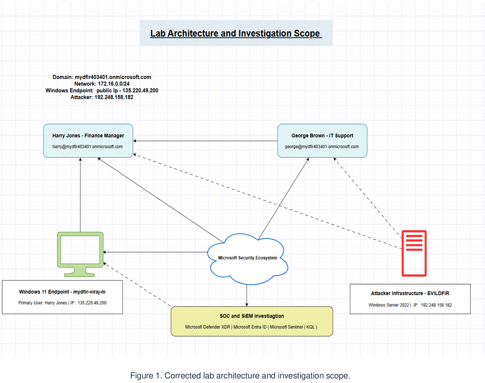

# Evaluating Enterprise Security Controls Through Controlled Multi-Stage Attack Simulation

An Investigation of Microsoft Defender XDR and Microsoft Sentinel for Enterprise Threat Detection and Incident Response 

## Project Architecture

The diagram below provides an overview of the controlled lab environment, including the test identities, Windows endpoint, attacker infrastructure and Microsoft security monitoring components.

*Figure 1. Lab architecture and investigation scope.*

## Objective

This project involved simulating a controlled multi-stage cyber attack within a Microsoft 365 environment and investigating the resulting activities from a Security Operations Center (SOC) perspective.

The exercise covered phishing simulations, identity-based access, internal spear phishing, endpoint activity, threat detection and incident response. Microsoft Defender XDR was used for security monitoring, investigation and containment, while Microsoft Sentinel was used to verify the ingestion of Defender incident data.

## Skills Learned

- Microsoft Defender XDR incident investigation and alert triage.
- Microsoft Entra ID sign-in analysis and identity investigation.
- Email threat investigation and phishing analysis.
- Endpoint process analysis and security event investigation.
- Incident response, user containment and device isolation.
- KQL queries and Microsoft Sentinel log investigation.
- MITRE ATT&CK mapping and attack timeline analysis.

## Tools & Technologies Used

  
  
  
  
  
  
  
  
  
  
  

## Project Documentation

The complete project report includes the lab architecture, implementation steps, screenshots, attack simulation phases, SOC investigation, incident timeline, findings, MITRE ATT&CK mapping and recommendations.

[View the Complete Project Report (PDF)](./Enterprise_Security_Assessment_Report.pdf)
